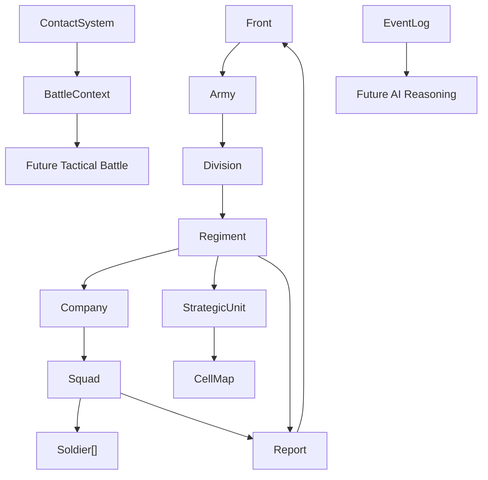

# Stage 0.5 and Stage 1 Prototype

## Stage 0.5 Foundation

Completed foundation rules:

- Soldier is not a CommandUnit.
- Command hierarchy ends at Squad.
- Squad owns `soldiers: Array` as executable personnel data.
- CommandUnit owns `unit_state: UnitState` instead of raw strength/ammo/fatigue fields.
- Orders have lifecycle validation.
- EventLog records core domain events.
- BattleContext exists as the bridge between strategic contact and future tactical battle.

## Stage 1 Strategic Prototype

The current strategic prototype is intentionally minimal. It is not the final strategic game layer.

Implemented:

- CellMap grid.
- Terrain data with movement cost and supply modifier.
- StrategicUnit wrapper that references a CommandUnit.
- MovementSystem for cell-to-cell movement.
- ContactSystem for opposing units entering contact.
- BattleContext creation from strategic contact.
- Strategic snapshot stored inside BattleContext.
- EventLog entries for unit movement and contact.

Current next work:

- send strategic reports upward when contact occurs;
- connect command Orders to StrategicUnit movement;
- add simple occupancy/stacking rules;
- prepare clean tactical handoff without implementing combat.

## Object Relationship



## Verified Demo Flow

```text
Front delegates HOLD order
  -> Army
  -> Division
  -> Regiment
  -> Company
  -> Squad

Squad reports contact upward
Regiment requests reinforcement upward

StrategicUnit moves on CellMap
Enemy contact detected
BattleContext created
StrategicContact event recorded
```

## Not Implemented Yet

- UI.
- Fog of war.
- Supply network.
- Pathfinding.
- Tactical scene loading.
- Tactical combat.
- Shooting.
- Artillery.
- Tanks.